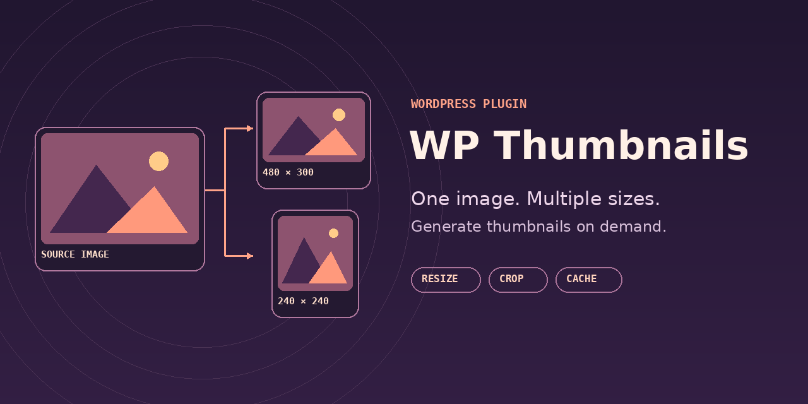

# WP Thumbnails

[](https://github.com/tikhomirov/wp-thumbnail-plugin/releases/latest)


Generate cropped or resized thumbnails on demand from WordPress attachments, then reuse them from the filesystem cache.

[Русская версия](README.ru.md)

## Requirements

- WordPress 5.6+ (the plugin header lists compatibility through 6.9).
- PHP 8.0+ and `mbstring`. The header and Composer metadata still list PHP 7.4, but the runtime uses PHP 8 syntax, including union types.
- Imagick or GD (Imagick is preferred when installed), and a writable cache directory under `wp-content/cache/thumb/`.

## Installation

1. Download the source ZIP from the [latest release](https://github.com/tikhomirov/wp-thumbnail-plugin/releases/latest) and extract it so that `wp-content/plugins/wp-thumbnail-plugin/wp-thumbnail-plugin.php` exists. For a Git-managed site, you can add the repository as a submodule at `wp-content/plugins/wp-thumbnail-plugin` instead.
2. Activate **Thumbnails** under **Plugins**. Composer is not required at runtime; the plugin ships its own autoloader.
3. Open **Settings → Thumbnails** to configure defaults and check the image processor and cache directory.

## Settings and formats

- **JPEG quality** sets the default quality (0–100; initially 90). Pass `quality` to override it per call.
- **WebP output** is off by default. Enable it for all generated thumbnails, or pass `'format' => 'webp'` for a single call. WebP requires support in the active image library. With neither a format override nor WebP enabled, output uses the source URL's extension. The processors list JPEG (`jpg`/`jpeg`), PNG, GIF and WebP (GD lists WebP only if its encoder is available).
- **No image placeholder** accepts a media attachment ID or a URL. The placeholder and **Do not show placeholder image** checkbox apply to the `get_post_thumbnail()` fallback, not to direct `thumb_*` calls. The external-host, upscaling and automatic cleanup fields do not enable remote fetching, control upscaling or schedule cache cleanup in the current generator.
- **Clear Cache** deletes generated thumbnails. The next request for a size regenerates it from the original.

## PHP templates

Call these helpers after WordPress `init`, for example in a theme template. Pass a local media attachment ID as the second argument (or use `attach_id` in the options). Use `post_id` to select a post's featured image. Although the signature accepts URLs, a bare URL does not provide the local file path required for generation; this API does not download remote images or search post content for a source.

```php
$attachment_id = get_post_thumbnail_id();

if ($attachment_id) {
    $size = ['width' => 480, 'height' => 320, 'crop' => true];

    $url = thumb_src($size, $attachment_id); // URL, or '' if unavailable.
    echo thumb_img($size + ['class' => 'post-cover', 'alt' => get_the_title()], $attachment_id);
    echo thumb_a_img($size, $attachment_id); // Image linked to the original.
}
```

Choose one helper for the output you need. Use `esc_url()` if you insert the URL returned by `thumb_src()` into HTML. `crop => false` resizes without cropping. `thumb_img()` and `thumb_a_img()` return an empty string when generation fails; the linked variant can return just the image when no original URL is resolved. The `kama_thumb_*` names remain as compatibility wrappers. See the [API reference](docs/CURRENT_API.md) for signatures.

## Companion plugin

[Taxonomy Thumbnail](https://github.com/tikhomirov/wp-term-thumbnail-plugin) assigns images to taxonomy terms and lets posts inherit a fallback cover from a term. WP Thumbnails generates image files at the requested dimensions; it does not manage those assignments. Use both if you need term-based covers and generated thumbnails.

[Changelog](CHANGELOG.md) · GPL-2.0-or-later
