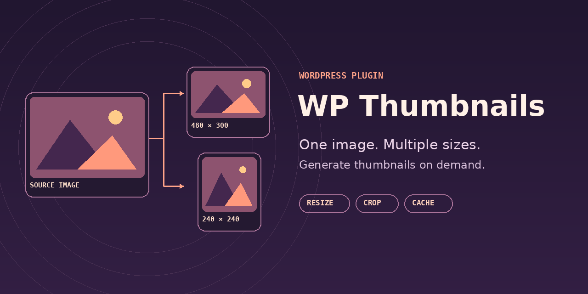

<p align="center">
  
</p>

<h1 align="center">WP Thumbnails</h1>

<p align="center">
  <strong>Генерация и кэширование миниатюр WordPress по запросу</strong><br>
  Плагин масштабирует или обрезает локальные вложения и сохраняет результаты в файловом кэше.
</p>

<p align="center">
  <a href="https://packagist.org/packages/rwsite/wp-thumbnail-plugin"></a>
  <a href="https://github.com/tikhomirov/wp-thumbnail-plugin/releases/latest"></a>
  
  
  
</p>

<p align="center">
  <a href="#требования">Требования</a> •
  <a href="#установка">Установка</a> •
  <a href="#настройки-и-форматы">Настройки</a> •
  <a href="#php-в-шаблонах">PHP в шаблонах</a> •
  <a href="#связанный-плагин">Связанный плагин</a> •
  <a href="README.md">EN version</a>
</p>

---

## Требования

- WordPress 5.6+ (в заголовке плагина указана совместимость до версии 6.9).
- PHP 8.0+ и `mbstring`. В заголовке плагина и метаданных Composer ещё указан PHP 7.4, но код использует синтаксис PHP 8, в том числе объединённые типы.
- Imagick или GD (при наличии выбирается Imagick) и доступный для записи каталог `wp-content/cache/thumb/`.

## Установка

### Через Composer

```bash
composer require rwsite/wp-thumbnail-plugin
```

### Ручная установка

1. Скачайте ZIP с исходным кодом [последнего релиза](https://github.com/tikhomirov/wp-thumbnail-plugin/releases/latest) и распакуйте так, чтобы появился файл `wp-content/plugins/wp-thumbnail-plugin/wp-thumbnail-plugin.php`. Если сайт хранится в Git, можно подключить репозиторий как подмодуль по тому же пути.
2. Активируйте **Thumbnails** в разделе **Плагины**. Для работы Composer не нужен: в плагине есть собственный автозагрузчик.
3. Откройте **Настройки → Thumbnails**, чтобы задать параметры и проверить библиотеку обработки изображений и каталог кэша.

## Настройки и форматы

- **Качество JPEG** задаёт качество по умолчанию (0–100, изначально 90). Для отдельного вызова можно передать `quality`.
- **Вывод WebP** по умолчанию отключён. Включите его для всех миниатюр или передайте `'format' => 'webp'` в отдельном вызове. WebP требует поддержки в выбранной библиотеке. Если WebP выключен и формат не задан, используется расширение исходного URL. Обработчики указывают JPEG (`jpg`/`jpeg`), PNG, GIF и WebP (GD указывает WebP, только если доступен кодировщик).
- **Заглушка** принимает ID вложения или URL. Настройка заглушки и её отключение относятся к резервной обложке в `get_post_thumbnail()`, а не к прямым вызовам `thumb_*`. Поля внешних хостов, увеличения маленьких изображений и автоматической очистки не включают загрузку по URL, не управляют увеличением и не запускают очистку в текущем генераторе.
- **Очистить кэш** удаляет сгенерированные миниатюры. При следующем запросе нужная миниатюра будет создана заново из оригинала.

## PHP в шаблонах

Вызывайте функции после WordPress `init`, например в шаблоне темы. Передайте ID локального вложения вторым аргументом или в параметре `attach_id`. Параметр `post_id` выбирает миниатюру записи. Сигнатура допускает URL, но сам URL не даёт генератору путь к локальному файлу: этот API не загружает внешние изображения и не ищет исходник в тексте записи.

```php
$attachment_id = get_post_thumbnail_id();

if ($attachment_id) {
    $size = ['width' => 480, 'height' => 320, 'crop' => true];

    $url = thumb_src($size, $attachment_id); // URL или '', если миниатюра недоступна.
    echo thumb_img($size + ['class' => 'post-cover', 'alt' => get_the_title()], $attachment_id);
    echo thumb_a_img($size, $attachment_id); // Изображение со ссылкой на оригинал.
}
```

Выберите одну функцию под нужный тип вывода. При вставке URL из `thumb_src()` в HTML используйте `esc_url()`. Параметр `crop => false` масштабирует без обрезки. Если генерация не удалась, `thumb_img()` и `thumb_a_img()` возвращают пустую строку. Если URL оригинала не найден, `thumb_a_img()` может вернуть изображение без ссылки. Имена `kama_thumb_*` сохранены для совместимости. Сигнатуры приведены в [справочнике API](docs/CURRENT_API.md).

## Связанный плагин

[Taxonomy Thumbnail](https://github.com/tikhomirov/wp-term-thumbnail-plugin) добавляет изображения терминам таксономий и позволяет записям наследовать резервную обложку от термина. WP Thumbnails создаёт файлы изображений нужного размера, но не управляет назначением обложек. Плагины можно использовать вместе.

## История изменений

См. [CHANGELOG.md](CHANGELOG.md).

## Лицензия

GPL-2.0-or-later

## Автор

Aleksei Tikhomirov (https://rwsite.ru)
